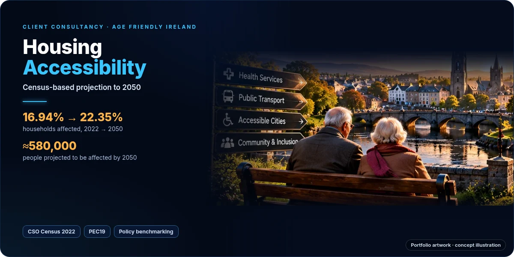

# The Rising Step — Forecasting Household Stair Accessibility in Ireland (2022–2050)

  

A live, interactive dashboard projecting how many Irish households will contain at least one
person with stair-related mobility difficulty, from 2022 through 2050.

**Live dashboard:** https://age-friendly-ireland.netlify.app/

**Full project write-up** (client brief, method, policy benchmarking and recommendations): [housing-accessibility-ireland](https://github.com/basant-kumarr/housing-accessibility-ireland)

  

## Project context

Built as part of an MSc Business Analytics consultancy project for **Age Friendly Ireland**
(Maynooth University). The client asked for a defensible estimate of the share of Irish
households likely to face stair, walking, reaching, lifting or carrying difficulty (CSO Q15(c)),
with projections to 2030, 2040, and 2050.

## Key findings

- Household share affected rises from **16.94% (2022)** to **22.35% (2050)**
- Roughly **580,000 people** projected to be affected by 2050
- Adults aged **65+** account for nearly all of the projected growth
- Older women show consistently higher reported prevalence than older men across every age band

## Method

A prevalence × projection model: age-and-sex disability rates from Census 2022 (CSO Statistic
F4006) are held constant and applied forward to official population projections (CSO Statistic
PEC19, Method M2) — the same family of approach used in Sullivan-method disability and
long-term-care planning across Europe.

This was chosen over:
- **Time-series forecasting (ARIMA/ETS)** — Ireland's Q15(c) wording is too recent to support a
  reliable historical series.
- **Dynamic microsimulation** — would need individual-level onset/recovery transition data that
  doesn't yet exist matched to Census wording in Ireland.

Full methodology, assumptions, and limitations are documented inside the dashboard itself
(sections 02 and 05).

## Data sources

- CSO Census of Population 2022
- CSO F4006 — Disability by age and sex
- CSO PEC19 — Population Projections (Method M2)

[cso.ie — Summary Results](https://www.cso.ie/en/releasesandpublications/ep/p-cpsr/censusofpopulation2022-summaryresults/healthdisabilitycaringandvolunteering/)

## Tech

Single-file HTML/CSS/vanilla JavaScript. Charts are hand-built inline SVG (no external chart
library) for zero dependency risk. No build step — `index.html` is the entire app.

## Limitations

- Does not model future medical or assistive-technology advances
- Does not account for migration-related shifts in disability prevalence
- Household composition is held constant at the 2022 distribution
- No county-level breakdown — CSO disability prevalence data is not available at that
  geographic resolution, so one wasn't fabricated

## Author

**Basant Kumar** — MSc Business Analytics, Maynooth University ·
[Portfolio](https://basant-kumar-portfoli.netlify.app/) · [LinkedIn](https://www.linkedin.com/in/basantsingh-/) · [GitHub](https://github.com/basant-kumarr)
